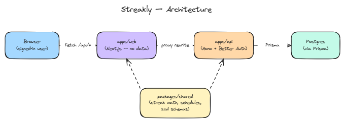

# Streakly

A habit tracker. You create goals ("run", "read"), check in on the days
you do them, and the app counts your streak — how many scheduled days in
a row you kept it up. Each cadence (daily, specific weekdays, or a weekly
quota) is counted in its own unit, and "today" is always the signed-in
user's own day, computed from their time zone.

This document describes how the codebase is put together: the three
pieces, how a request flows through them, the data model, and how to
run it locally. For the product rules (what a streak means, what rest
days do) see `PRODUCT.md`. For the history of technical decisions and
why each one was made, see `DEV_NOTES.md`.

## The three pieces

Streakly is a TypeScript monorepo with three workspaces:

- **`apps/web`** — the website (Next.js + React). It holds no data of
  its own. Every data request it makes goes out as `/api/...` and is
  proxied straight through to the api (see `next.config.ts`).
- **`apps/api`** — the server (Hono, running on Bun). It is the only
  thing that touches the database (Postgres, via Prisma) and the only
  thing that knows how login works (Better Auth).
- **`packages/shared`** — plain logic and types both sides import:
  streak math, schedule rules, date/time-zone helpers, and the zod
  schemas used for form and request validation. Its one rule: it may
  only depend on `date-fns` and `zod` — no Prisma, no React, no
  Next.js. That restriction is what lets both the browser and the
  server use the exact same code for anything that isn't UI or
  storage.



(Editable source: `docs/architecture.excalidraw`, open at
[excalidraw.com](https://excalidraw.com).)

The browser never talks to `apps/api` directly. It calls same-origin
paths on the website; Next's `rewrites()` forwards anything under
`/api/*` to the api's origin (`API_PROXY_URL`, default
`http://localhost:4000` in dev, the `api` container's address in
Docker). That keeps cookies same-site and means the web app never
needs CORS configuration.

Why split the server out of Next.js at all, instead of using Next's
own API routes? Because Streakly is meant to grow into a native app
(Expo) later, which needs an API that doesn't assume a Next.js
request/response cycle. A standalone Hono server is the thing that
API can call on day one.

## Request flow: checking in on a goal

1. The browser sends `POST /api/goals/:id/checkins` to check in, or
   `DELETE /api/goals/:id/checkins?date=...` to undo it, through
   `apiFetch` (`apps/web/src/lib/api-fetch.ts`). That helper also treats
   a 401 as "session expired" and redirects to `/sign-in` instead of
   surfacing an error. Each request says the state the user wants, so
   sending it twice changes nothing.
2. Next's rewrite forwards the request, cookies and all, to
   `apps/api`.
3. `apps/api/src/app.ts` gives the request an id for the access log
   (`lib/observability.ts`) and refuses bodies over 64 KiB, then routes it
   to `apps/api/src/routes/goals.ts`. Before any handler runs,
   `authenticateSession` (`lib/auth.ts`) resolves the session cookie via
   Better Auth and puts `userId` and the user's stored `timeZone` on the
   request context, and `goalRateLimit` (`lib/rate-limit.ts`) counts the
   request against that user's per-minute budget. No session means a 401
   before the request body is even looked at.
4. The handler accepts only `application/json` bodies and validates them
   against a zod schema from `packages/shared`, then calls into
   `lib/goals.ts`, which is the only code that talks to Prisma. Every
   query there is scoped by `userId`; there is no code path that can read
   another user's goals.
5. `computeStreaks` (`packages/shared/src/streaks.ts`) turns raw
   check-in rows into the streak numbers the card displays. This math
   runs **only** on the server; the browser receives finished numbers
   and only renders them, so the two sides can never disagree about
   what a streak is.
6. The response is plain JSON, with errors in one shape: `handleError`
   (`lib/observability.ts`) turns a thrown `HttpError` into
   `{ error }` with its status. Anything unexpected becomes a generic 500
   that carries the request id, so a user's screenshot matches one log
   line.

## Data model

Six tables, defined in `prisma/schema.prisma` (Postgres):

- **`Goal`** — one habit. Belongs to a `User` via `userId`. Carries its
  display info (name, color, icon, sort order) and its `schedule` —
  a single JSON column holding `null` (daily) or `{ type: "weekdays" |
  "weekly", ... }`, validated by a zod schema rather than split across
  columns.
- **`CheckIn`** — one day a goal was completed. No `userId` of its
  own: ownership flows through the goal it belongs to. Stored as a
  plain SQL date; the api converts to and from a `YYYY-MM-DD` string
  at the boundary so streak math never has to reason about time zones
  itself.
- **`User`, `Session`, `Account`, `Verification`** — owned by Better
  Auth, not hand-rolled. `Account` is one login *method* for a user
  (e.g. the `credential` row holding a password hash), not a billable
  entity — relevant if Streakly ever adds OAuth providers, since each
  one is just another `Account` row, no schema change. `User` also
  carries the browser-reported IANA `timezone`, which is what makes
  "today" mean the user's day rather than the server's.

IDs are server-generated Postgres UUIDs (`gen_random_uuid()`), not
auto-increment integers, so a goal or check-in's ID can't be guessed
or enumerated by incrementing it.

## Authentication

Better Auth (`apps/api/src/lib/auth.ts`) owns sign-up, sign-in,
sessions and password reset; the app code never touches a password or
a session token directly, only `session.user.id`. Notable choices:

- Email/password only for now. The schema is shaped so adding Google
  or GitHub sign-in later is an `Account` insert, not a migration.
- The api refuses to boot outside `development`/`test` unless
  `BETTER_AUTH_SECRET` (32+ chars), `BETTER_AUTH_URL`,
  `RESEND_API_KEY`, `EMAIL_FROM` and `CLIENT_IP_HEADER` are all set
  (`lib/env-guard.ts`) — a misconfigured production deploy fails loudly
  at startup instead of silently running with a forgeable dev secret.
- Rate limiting is on everywhere except the test suite, with tighter
  limits on `/sign-in/email`, `/sign-up/email`, `/change-password` and
  `/request-password-reset` than the general API. Limits are per client
  IP, read only from the header the host's edge sets
  (`CLIENT_IP_HEADER`), never from `X-Forwarded-For`, which any client
  can fake. Goal routes have their own per-user limits (120 reads and 60
  writes a minute).
- Password reset emails go out through Resend, fired without being
  awaited, so the reset form answers the same, equally fast, for a
  registered email and an unregistered one. Sign-up still reveals
  whether an email has an account (a taken email is refused); that is an
  accepted known limit, listed in `DEPLOY.md`.

## Running it locally

Requirements: Bun, Docker (for Postgres).

```
cp .env.example .env        # dev values for every variable
docker compose up -d        # starts Postgres only, on localhost:5432
bun install
bun run db:migrate          # applies prisma/migrations
bun run dev                 # starts apps/web (which proxies to apps/api)
```

`apps/web`'s `dev` script only starts the website; run `apps/api`'s own
`dev` script (`bun run --cwd apps/api dev`) alongside it for the API to
have somewhere to proxy to. `.env` is never committed; `.env.example`
lists every variable with a dev value and says what production needs.

`docker compose --profile app up -d --build` additionally builds and
runs the production images (`apps/api/Dockerfile`, `apps/web/Dockerfile`)
against the same database, with the website on http://localhost:3100,
for testing the deployed shape locally.

Checks (CI runs the same four on every PR):

```
bun run typecheck
bun run lint
bun test packages apps/web
cd apps/api && bun run test   # needs the Docker database running
```

Every test command runs with `--isolate`, so each test file gets its own
copy of the app and the api tests can never reach the dev database.

## Further reading

- `PRODUCT.md` — what the app does and the rules a streak follows.
- `DEV_NOTES.md` — every architectural decision, in order, with the
  problem it solved and the PR it shipped in, plus the worst bugs so far.
- `DEPLOY.md` — the checklist for deploying: host requirements,
  environment variables, first-boot checks, known limits, rollback.
- `packages/shared/README.md` — the one-paragraph rule for that
  package.
